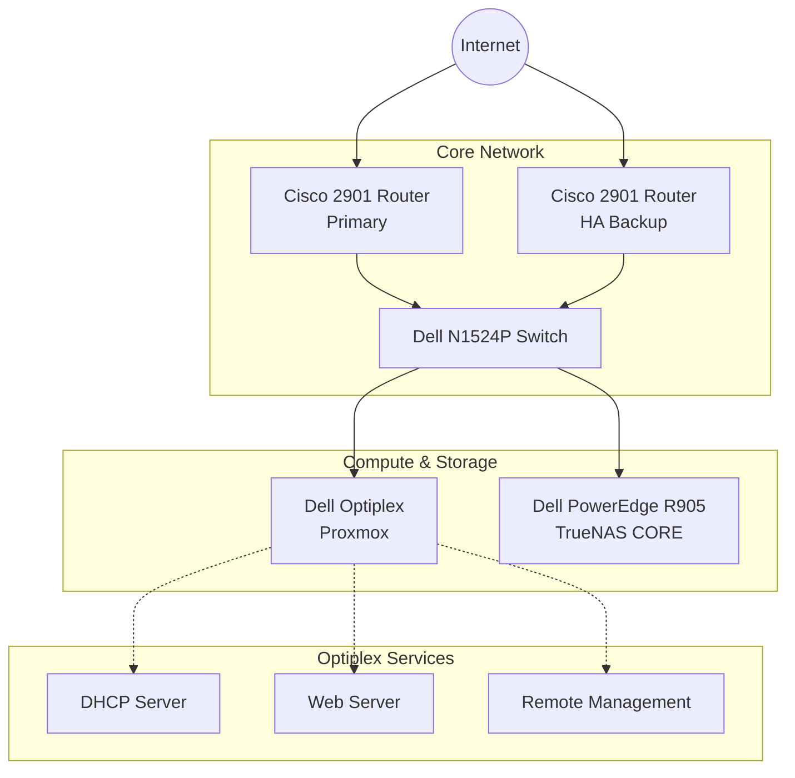

# Cheapest Home Data Center Ever
A detailed look at how I made a data center with $20 and a dream.
## Architecture Overview
The core network is routed through 2 Cisco 2901 routers set up for high availability into a Dell N1524P switch that connects to 2 server computers, a Dell Optiplex and a Dell PowerEdge R905. The R905 is running TrueNas Core while the Optiplex is running Proxmox to handle the DHCP, web server, and remote management with Tailscale.

## Hardware Inventory

| Device | Role | Form Factor | CPU / Memory | Ports & Storage / Notes |
| :--- | :--- | :--- | :--- | :--- |
| **Cisco 2901 (Primary)** | Core Router / Firewall | 1U Rackmount | 512MB DRAM | 2x 1GbE WAN, 4x EHWIC slots |
| **Cisco 2901 (HA Backup)**| Redundant Router | 1U Rackmount | 512MB DRAM | Configured for High Availability |
| **Dell N1524P** | Main Switch | 1U Rackmount | 1GB CPU Memory | 24x 1GbE PoE+ (30W), 4x 10GbE SFP+ |
| **Dell Optiplex** | Hypervisor (Proxmox) | Tower | Intel Core i7-4790 / 32GB DDR3 | 1x 1gbE LAN / Hosts DHCP, Web Server, & Mgmt VMs |
| **Dell PowerEdge R905** | NAS (TrueNAS CORE) | 4U Rackmount | 4x AMD Opteron 8384 / 128GB DDR2 | PERC 6/i RAID Controller, 2x 10gbE LAN / Basic storage device, stores ISOs for Optiplex |

## Why I choose these devices
If you are trying to replicate this, you have to be patient in finding any kind of networking equipment. Most of these devices came from an office shutting down and giving away their networking equipment and computers. The only computer I bought was the R905 for $20 on Facebook Marketplace. This may seem like luck but companies do get rid of old tech and list it on marketplaces quite frequently and it just takes time.

### Routers
The company gave me 2 router that they were using to separate networks withing their office but, at least for my use case, I don't need 2 different networks. One of the best ways to make a reliable network setup is to have high availability with 2 or more routers. This might seem a little overkill but having the best uptime sets you aside from others especially when self-hosting.

### Switch
The switch was also given to me by the company and works very well within this setup. It has 24 gbE ports with POE+ so if I wanted to add an access point, it would be very easy to do so. It is also a managed switch which is very helpful for setting up the VLANs and the uplink ports.

### Servers
There will have to be some drawbacks with having such a cheap setup and most of those drawbacks will be with the actual servers. The R905, while looking good on paper, is still very old and will not run any modern OS. That is why I had to go with TrueNAS Core instead of Scale or another operating system that would have taken advantage of the extra ram. It uses 64 bit v1 processing so I needed a computer that could do 64 bit v2 processing. That is what the Optiplex is for. It runs Proxmox so that I can have separate environments for my web server and dhcp server. I also use this server to remotely manage anything on the network using Tailscale. 
